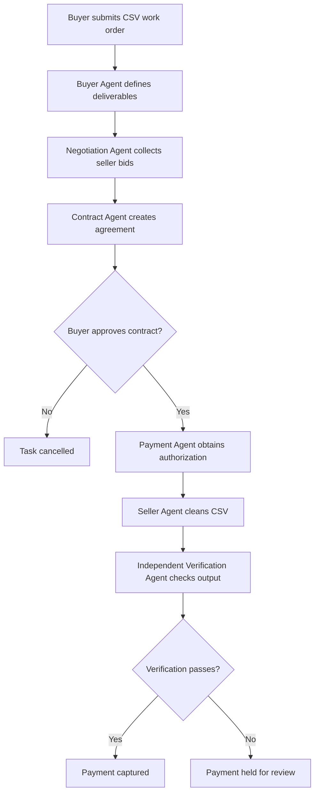

# AgentPay

**An autonomous marketplace for task delegation, seller bidding, digital contracts, independent verification, and conditional payment settlement.**

AgentPay demonstrates how specialized software agents can coordinate a small, auditable service transaction. A buyer submits a CSV-cleaning work order, registered sellers return bids, a contract is generated for approval, and the selected seller delivers a cleaned file. Payment is captured only after an independent verifier approves the output.

> **Current scope:** AgentPay is a local demonstration application. The seller catalogue is seeded, the default payment adapter is simulated, and authentication is not implemented. PayPal Sandbox checkout is supported when sandbox credentials are configured. Do not use this release to process real payments or sensitive production data.

## Product workflow



### Specialized agents

| Agent | Responsibility |
|---|---|
| Buyer Agent | Converts the request into deliverables and acceptance criteria while preserving the buyer's budget. |
| Negotiation Agent | Collects eligible bids and ranks them by price, delivery estimate, and seller rating. |
| Contract Agent | Creates the agreement, including deliverables, deadline, revision policy, and payment conditions. |
| Seller Agent | Normalizes CSV headers and text, removes exact duplicate rows, and produces a processing report. |
| Independent Verification Agent | Checks missing values, empty outputs, duplicate rows, email formats, and formatting before settlement. |
| PayPal Payment Agent | Creates or simulates payment authorization and captures funds only after verification passes. |

## Key behaviours

- **Budget enforcement:** Work orders are capped at USD 5.00. The selected bid must fit within the buyer's submitted budget.
- **Seller eligibility:** Only sellers within the task budget and delivery deadline are considered.
- **Reproducible selection:** Bids are scored using price (50%), delivery time (25%), and seller rating (25%).
- **Conservative data handling:** The CSV cleaner preserves source fields as text, including literal values such as `NA` and identifiers with leading zeros. It trims surrounding whitespace, standardizes column names, removes exact duplicate rows, and removes fully empty rows. It does not guess missing values, fabricate email addresses, or copy values between customer records.
- **Deterministic agent decisions:** The included seller catalogue and bid scoring are built-in demo fixtures. AgentPay demonstrates orchestration and payment controls, not a live third-party agent network.
- **Independent verification:** Missing values or invalid email addresses remain visible as failed checks. A failed verification prevents payment capture and places the payment on hold.
- **Idempotent workflow operations:** Starting an existing work order or approving an already completed contract does not create duplicate contracts, executions, verification reports, or payments.
- **Downloadable deliverable:** A cleaned CSV is available from the task download endpoint once seller execution has completed.
- **Live status updates:** Task events can be consumed over WebSockets.

## Technology stack

| Layer | Technology |
|---|---|
| Frontend | React 18, TypeScript, Vite, Tailwind CSS, React Router, Axios |
| Backend | Python, FastAPI, Pydantic, SQLAlchemy |
| Data processing | pandas |
| Database | SQLite by default; SQLAlchemy-compatible database URLs are configurable |
| Payments | Local simulated adapter by default, PayPal REST API Sandbox when credentials are supplied |
| Realtime | FastAPI WebSockets |

## Repository layout

```text
AgentPay/
├── backend/
│   ├── agents/                 # Six specialized agents
│   ├── api/                    # REST endpoints and WebSocket endpoint
│   ├── database/               # SQLAlchemy models and initialization
│   ├── services/               # CSV pipeline and PayPal adapter
│   ├── workflows/              # End-to-end transaction orchestration
│   ├── tests/                  # Automated backend tests
│   ├── uploads/                # Runtime upload and output directory
│   ├── main.py                 # FastAPI application
│   └── requirements.txt
├── examples/
│   └── sample_customers.csv
├── frontend/
│   ├── src/
│   │   ├── pages/              # Marketplace dashboard and workflow screens
│   │   ├── services/           # Typed API client
│   │   └── hooks/              # WebSocket hook
│   ├── package.json
│   └── vite.config.ts
├── .env.example
├── .gitignore
└── README.md
```

## Getting started

### Prerequisites

- Python 3.10 or newer
- Node.js 18 or newer
- npm

### 1. Clone and configure

```bash
git clone https://github.com/<your-account>/AgentPay.git
cd AgentPay
cp .env.example .env
```

On Windows PowerShell, use `Copy-Item .env.example .env` instead of `cp`.

The default configuration uses SQLite and the simulated payment adapter. No external service credentials are required for local development.

### 2. Start the backend

```bash
python -m venv .venv

# macOS / Linux
source .venv/bin/activate

# Windows PowerShell
# .venv\Scripts\Activate.ps1

pip install -r backend/requirements.txt
cd backend
uvicorn main:app --reload --host 127.0.0.1 --port 8000
```

The API is available at `http://127.0.0.1:8000`. Interactive API documentation is available at `http://127.0.0.1:8000/docs`, and the health check is at `http://127.0.0.1:8000/health`.

The SQLite database is created automatically in `backend/agentpay.db`. Uploaded source files and generated output files are stored in `backend/uploads/`. These runtime files are excluded from Git.

### 3. Start the frontend

Open a second terminal from the repository root:

```bash
cd frontend
npm install
npm run dev
```

Open `http://localhost:5173`. The Vite development server proxies `/api` requests to the backend on port `8000`.

### 4. Run the sample workflow

1. Open **Create Task**.
2. Use `examples/sample_customers.csv` as the input file.
3. Submit a work order with a budget up to USD 5.00.
4. Review seller bids in **Negotiation**.
5. Review and approve the agreement in **Contract Approval**.
6. In default demo mode, the seller executes immediately. The verification report and payment outcome appear in the dashboard, verification center, and transactions page.
7. Download the cleaned CSV from the contract or verification screen.

The sample file contains a duplicate row and inconsistent header formatting so the cleaning process has visible work to perform while still meeting the automated checks.

## PayPal Sandbox configuration

The local simulated payment adapter is enabled whenever either PayPal credential is absent. This mode creates clearly labelled mock order, authorization, and capture references. It does not contact PayPal or move money.

To test the checkout redirect with PayPal Sandbox, add your Sandbox REST application credentials to the root `.env` file:

```dotenv
PAYPAL_CLIENT_ID=your_sandbox_client_id
PAYPAL_CLIENT_SECRET=your_sandbox_client_secret
PAYPAL_BASE_URL=https://api-m.sandbox.paypal.com
PAYPAL_RETURN_URL=http://localhost:5173/payment/return
PAYPAL_CANCEL_URL=http://localhost:5173/contract
```

Restart the backend after changing the environment. Once the buyer approves a contract, AgentPay creates an authorization-intent order and provides the PayPal approval link. The browser returns to the payment callback, where the backend completes authorization. Seller execution then begins. Capture is attempted only after the independent verification report has a `pass` status.

Use only PayPal Sandbox accounts and credentials for this integration test. Keep `.env` out of version control. The payment flow is not a production payment service and has not been certified for live transactions.

## Configuration reference

| Variable | Purpose | Default |
|---|---|---|
| `DATABASE_URL` | SQLAlchemy database connection URL | `sqlite:///./agentpay.db` |
| `PAYPAL_CLIENT_ID` | PayPal Sandbox REST client ID | Empty, uses simulation |
| `PAYPAL_CLIENT_SECRET` | PayPal Sandbox REST secret | Empty, uses simulation |
| `PAYPAL_BASE_URL` | PayPal API base URL | `https://api-m.sandbox.paypal.com` |
| `PAYPAL_RETURN_URL` | Browser return route after checkout approval | `http://localhost:5173/payment/return` |
| `PAYPAL_CANCEL_URL` | Browser route when checkout is cancelled | `http://localhost:5173/contract` |
| `BACKEND_HOST` | Backend bind address | `127.0.0.1` |
| `BACKEND_PORT` | Backend port | `8000` |
| `FRONTEND_URL` | Frontend origin | `http://localhost:5173` |
| `CORS_ORIGINS` | Comma-separated allowed browser origins | `http://localhost:5173` |
| `MAX_CSV_SIZE_MB` | Maximum CSV upload size | `5` |

## API reference

All REST routes are prefixed with `/api`.

| Method | Endpoint | Description |
|---|---|---|
| `POST` | `/tasks` | Create a work order and upload its source CSV |
| `GET` | `/tasks` | List recent tasks |
| `GET` | `/tasks/{task_id}` | Retrieve task details |
| `GET` | `/tasks/{task_id}/download` | Download the cleaned CSV artifact |
| `POST` | `/tasks/{task_id}/start` | Run buyer decomposition, negotiation, and contract generation |
| `POST` | `/tasks/{task_id}/execute` | Execute a task after payment authorization |
| `POST` | `/negotiations/{task_id}/start` | Start or retrieve seller negotiation |
| `GET` | `/negotiations/{task_id}/bids` | List seller bids |
| `GET` | `/contracts/{task_id}` | Retrieve the contract |
| `POST` | `/contracts/{task_id}/approve` | Approve the contract and begin payment authorization |
| `POST` | `/contracts/{task_id}/reject` | Reject the pending contract |
| `POST` | `/payments/{task_id}/authorize` | Create or retrieve an authorization for an approved contract |
| `POST` | `/payments/{task_id}/complete-authorization` | Complete PayPal authorization after checkout approval |
| `GET` | `/transactions` | List payment records |
| `GET` | `/verification/{task_id}` | Retrieve the verification report |
| `POST` | `/verification/{task_id}/run` | Re-run verification on an existing output |
| `GET` | `/agents` | Retrieve agent activity summaries |
| `GET` | `/dashboard/stats` | Retrieve marketplace statistics |
| `WS` | `/ws/tasks/{task_id}` | Subscribe to task events |

## Tests

Run the automated backend suite:

```bash
cd backend
python -m pytest -q
```

The tests cover CSV normalization, preservation of unresolved values, successful end-to-end execution, verification failures, payment holds, and budget validation. The default test suite uses an isolated temporary SQLite database and the simulated payment adapter.

## Security and deployment notes

- This demo does not implement user authentication, authorization, tenant isolation, or production-grade file retention.
- The seller catalogue is a built-in fixture. It demonstrates bid scoring and contract selection, not a live external vendor network.
- The default payment mode is simulated. PayPal Sandbox support is intended for integration testing only.
- Do not upload personal, financial, health, or otherwise sensitive data.
- Before deployment, add authentication and authorization, database migrations, audit retention controls, rate limiting, malware scanning, object storage, secrets management, monitoring, and a reviewed payment operations process.

## License

### Copyright

Copyright © 2026 Rohit Kattimani. All rights reserved.
